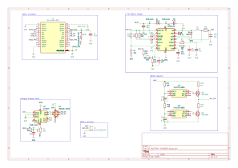

# 2S Battery Charger

USB-C powered charger for a 2-cell (2S) Li-ion battery pack, designed in
KiCad. The board requests a higher voltage from a USB-C Power Delivery
source (CH224K), charges the pack with a switching charger (MP26123) and
balances the two cells with a bleed-resistor circuit.

## Main components

| Ref | Part | Role |
|-----|------|------|
| J1 | SS-52400-002 | USB-C connector |
| F1 | 0ZCG0260FF2C | Resettable fuse on VBUS |
| U2 | CH224K | USB-C PD sink controller |
| U3 | USBLC6-2SC6 | ESD protection for USB data lines |
| U1 | MP26123 | 2-cell Li-ion switching charger |
| L1 | 4.7 µH | Buck inductor |
| D1, D4 | SS34 | Schottky diodes |
| R9 | 100 mΩ | Charge current sense |
| D2, D3 | LED | Charge status (CHGOK, ACOK) |
| SW1 | Push button | Connected to the EN pin of the charger |
| IC1, IC2 | HY2213-BB3A | Per-cell voltage detection for balancing |
| Q1, Q2 | AO3400A | Balancing switches |
| R13, R14 | 62 Ω | Balancing (bleed) resistors |
| J2 | 1x03 pin header | Battery: VBAT, BAT_MID, GND |

Full bill of materials: [`2S-BATTERY-CHARGER.csv`](2S-BATTERY-CHARGER.csv).

  

<em>2S battery charger: SS-52400-002, MP26123, CH224K, HY2213-BB3A and others components.</em>

## How It Works

### 1. Power Input & Protocol Negotiation
When a USB Type-C cable is connected:
* **Voltage Negotiation:** The **CH224K** trigger negotiates the required input voltage level with the power source (USB-PD / QC) to ensure high efficiency for the step-down converter.
* **Circuit Protection:** The VBUS line is protected against overcurrent by the **F1** resettable fuse (PPTC), while the DP/DM data lines are safeguarded against electrostatic discharge (ESD) using the **USBLC6-2SC6** diode array.

### 2. Three-Phase Charging Algorithm
The **MP26123** PWM switching charger implements a complete 3-phase charging cycle for a 2S Li-Ion/LiPo battery pack (up to 8.4V):
1. **Trickle / Pre-Charge Phase:** If the battery is deeply discharged (below the safe threshold), the controller applies a low, limited current to safely recover the cells without causing damage.
2. **Constant Current (CC) Phase:** Once the battery reaches nominal voltage, fast charging engages at full target current, set and regulated via the **R9** ($100\text{ m}\Omega$) current-sense resistor.
3. **Constant Voltage (CV) Phase:** As the total pack voltage reaches 8.4V, the controller holds the voltage constant while gradually reducing the charging current until the termination threshold is met.

### 3. Autonomous Passive Balancing
The cell balancer operates independently from the main charger IC to prevent individual cell overcharging:
* **IC1** and **IC2** (HY2213) continuously monitor the voltage of each section in the 2S series pack via the `BAT_MID` node.
* If either cell reaches its balancing threshold (~4.2V), its corresponding controller switches on the **AO3400A** N-channel MOSFET (Q1 or Q2).
* A bleed current of ~68 mA ($I = \frac{4.2\text{V}}{62\,\Omega}$) is dissipated as heat through the bleed resistor (**R13** or **R14**), slowing down the charging rate of the higher-voltage cell and allowing the lagging cell to catch up.

### 4. Control & Status Indication
* **Status LEDs:** The `CHGOK` and `ACOK` pins control status LEDs **D2/D3** to indicate power presence, active charging, and charge completion.
* **User Control:** Pushbutton **SW1** is connected to the charger's `EN` pin, allowing manual enable, disable, or reset of the charging process.

